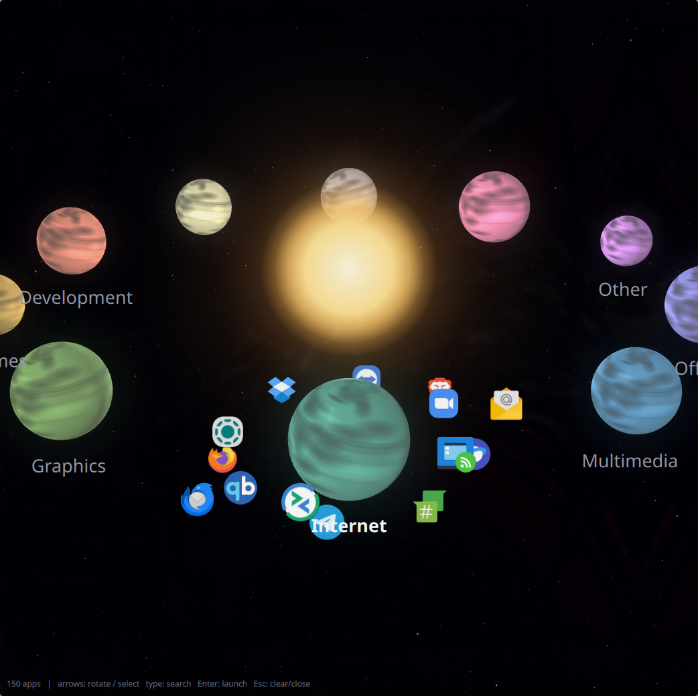
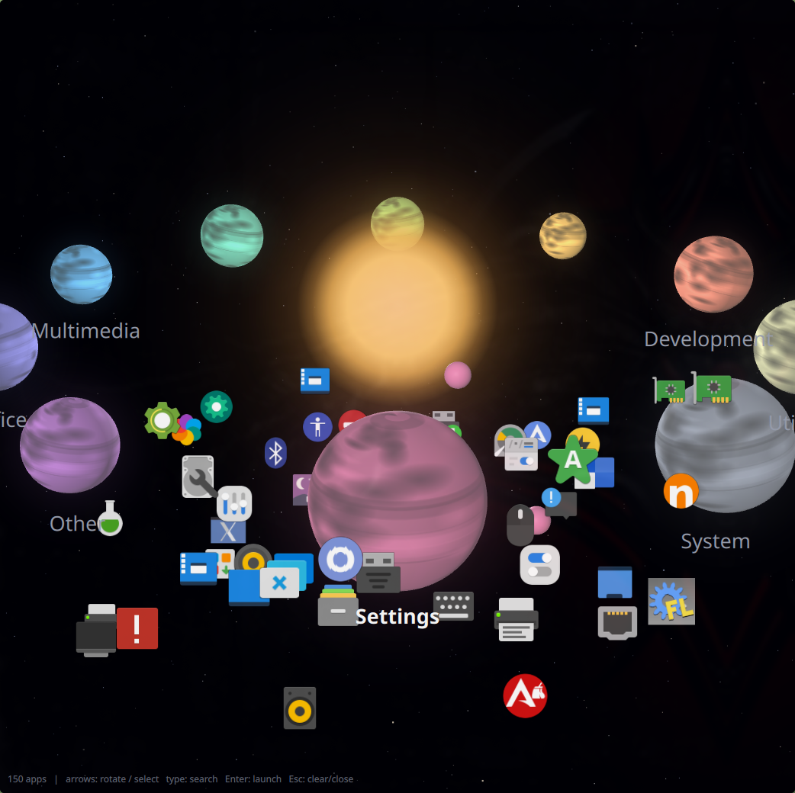

# kaos-launcher

Version 0.1.0

A 3D "solar system" application launcher for Linux, built with Qt Quick 3D inside a standalone Quickshell window.
Application categories are planets on a ring around a glowing sun; the apps of the focused planet orbit it as moons.
Rotate the ring with the mouse or the arrow keys, type to search, press Enter or click to launch.

## Features

- Categories as planets (size by app count), apps as moons with their real icons; plain spheres when no icon exists.
- Keyboard first: arrows rotate and select, Enter launches, type anywhere to search, Escape clears then closes.
- Fuzzy search on name, then keywords, then comment; the camera flies to the best match, even on another planet.
- Hover tooltip with name and comment.
- Resident background instance toggled by a command (instant open), or run-once mode.
- Recently launched apps (from kaos-launcher only) get a brighter glow; opens on the last focused planet.
- Reads standard `.desktop` files; handles `Terminal=true` apps and Exec field codes.
- Small TOML config file with commented defaults, created on first run.

| Search | Large category |
|--------|----------------|
|  |  |

## Requirements

Developed and tested on Arch Linux (Quickshell 0.3.2, Qt 6.12, Hyprland 0.57, Python 3.14). The window uses the Wayland
platform plugin through Quickshell.

| Component | Needed | Arch package | Notes |
|-----------|--------|--------------|-------|
| Quickshell | required | `quickshell` (0.3.x; tested 0.3.2) | Provides `quickshell`, `Quickshell.Io`, `Quickshell.Hyprland` QML modules |
| Qt Quick 3D | required | `qt6-quick3d` | The 3D scene; pulls `qt6-shadertools`, `qt6-quicktimeline` |
| Qt 6 base, Declarative, Wayland, SVG | required | `qt6-base`, `qt6-declarative`, `qt6-wayland`, `qt6-svg` | Already dependencies of `quickshell` |
| Python 3.11+ | required | `python` | Backend, standard library only (`tomllib` needs 3.11) |
| Wayland compositor | required | any | Quickshell windows need Wayland |
| Icon theme | optional | e.g. `papirus-icon-theme` | `hicolor-icon-theme` comes with Quickshell. Without a theme most apps are plain spheres |
| Terminal emulator | optional | e.g. `kitty`, `alacritty`, `foot` | Only for apps with `Terminal=true`; must accept `-e <command>` |
| Hyprland | optional | `hyprland` | Used only to open the panel on the monitor with the focused window; elsewhere the first screen is used |
| `gsettings` | optional | `glib2` | Only to detect the icon theme when GTK 3 `settings.ini` has none; fallback is hicolor |

External commands the code runs: `python3` (backend, from QML), `quickshell` (the wrapper script), `gsettings`
(optional, icon theme detection), and the configured or detected terminal (optional). It does not call `hyprctl`
and needs no clipboard tools.

Development and tests only:

| Tool | Arch package | Use |
|------|--------------|-----|
| `ruff` | `ruff` | Python lint and format check |
| `qmllint` | `qt6-declarative` | QML lint |
| `node` | `nodejs` | Tests for `search.js` |
| `shellcheck` | `shellcheck` | Lint for the wrapper script |
| `grim` | `grim` | Optional, for screenshots |

Install on Arch:

    sudo pacman -S quickshell qt6-quick3d python

Other distributions: untested. You need Quickshell (usually built from source or a third-party package), the Qt 6
Quick 3D QML module (Debian/Ubuntu/Linux Mint: `qml6-module-qtquick3d` and related `qml6-module-*` packages),
Python 3.11 or newer, and a Wayland session. Package names there are best-effort guesses.

## Install

    git clone https://github.com/pt-kaos/kaos-launcher.git
    cd kaos-launcher

Run it in place:

    quickshell -p /path/to/kaos-launcher -n

`-n` makes a second start exit at once, giving a single instance. The `kaos-launcher` script wraps both cases: if the
instance runs it toggles show/hide, otherwise it starts one. Optionally link it onto your `PATH`:

    ln -s /path/to/kaos-launcher/kaos-launcher ~/.local/bin/kaos-launcher

The script resolves symlinks, so it finds the application directory from the link.

## Usage

Start or toggle:

    kaos-launcher

Control a running instance directly (talks only to the instance started from that directory):

    quickshell ipc -p /path/to/kaos-launcher call launcher toggle     # or: show, hide

Start hidden (for autostart, shown at the first toggle): `KAOS_START_HIDDEN=1 quickshell -p /path/to/kaos-launcher -n`.

### Keys and mouse

| Input | Action |
|-------|--------|
| Left / Right | Rotate the ring to the previous / next planet |
| Up / Down | Select the previous / next moon of the focused planet (wraps) |
| Enter | Launch the selected moon (nothing selected: nothing happens) |
| Any text | Search (no click needed); Backspace edits |
| Escape | First press clears the search, second closes; with no search text it closes directly |
| Drag left/right | Rotate the ring, snapping to the nearest planet |
| Click a planet | Bring it to the front |
| Hover a moon | Freeze it and show name and comment |
| Click a moon | Launch it (detached, survives closing the launcher) |

### Search

Matching moons light up and the others dim; the camera flies to the best match and selects it. The search line shows
`position/total` or `no match`; planet labels show the match count per category. While searching, Up/Down cycle
through the matches (best first, across planets); Left/Right still rotate.

Ranking, on the name first (best to worst): exact, prefix, word start ("stu" in Visual Studio Code), subsequence
anchored on the first letter ("ff" in Firefox), substring, any other subsequence. Then `Keywords=`/`GenericName=`
(word start or substring), then `Comment=` (same). Any name match outranks any keyword match, which outranks any
comment match. Case and accents are ignored. Ties: shorter name, then alphabetical.

### Grouping

Applications are read from `$XDG_DATA_HOME/applications` (default `~/.local/share`), every `$XDG_DATA_DIRS` entry and
`/usr/share`; earlier directories override later ones by file id. Skipped: `NoDisplay`, `Hidden`, non-Application types,
entries without `Name` or `Exec`. The main group is the first match in this priority order against `Categories=`:
Settings, Games, Development, Graphics, Multimedia (AudioVideo/Audio/Video), Internet (Network), Office, System,
Utility; no match goes to Other. To change it, edit `GROUPS` in `kaos_launcher.py`.

### Icons

`Icon=` is resolved per the freedesktop icon theme specification: an absolute path is used if the file exists; a name
is searched in the active theme, its `Inherits=` chain, `hicolor`, then loose files in `pixmaps/` and the icon
directories (PNG and SVG; `.xpm` is not used). The active theme is `gtk-icon-theme-name` in
`$XDG_CONFIG_HOME/gtk-3.0/settings.ini`, else `gsettings get org.gnome.desktop.interface icon-theme`, else `hicolor`;
`icon_theme` in the config overrides it.

## Configuration

File: `$XDG_CONFIG_HOME/kaos-launcher/config.toml` (default `~/.config/kaos-launcher/config.toml`). It is created with
commented defaults on first run and never overwritten afterwards; `config.example.toml` in this repository is the same
file. Invalid TOML or a bad value falls back to the default for that key; numbers are clamped to their range; unknown
keys are ignored. Changes apply at the next hide/show cycle (see Background mode).

| Key | Default | Range | Meaning |
|-----|---------|-------|---------|
| `run_in_background` | `true` | bool | Keep one resident instance; `false` exits on Escape or after a launch |
| `recent_count` | `5` | 0-20 | Recent apps with a brighter glow (0 = off) |
| `panel_size_percent` | `50` | 20-100 | Panel width and height as a percentage of the screen |
| `close_after_launch` | `true` | bool | Hide (or exit) after launching |
| `orbit_speed` | `1.0` | 0-5 | Moon orbit speed, 0 stops the orbits |
| `starfield` | `true` | bool | Faint stars in the background |
| `icons` | `true` | bool | App icons on the moons; `false` shows plain spheres |
| `icon_theme` | `"auto"` | string | Icon theme name; `"auto"` = GTK settings, then gsettings, then hicolor |
| `terminal` | `"auto"` | string | Terminal for `Terminal=true` apps: `"auto"` (`$TERMINAL`, then kitty, alacritty, foot, wezterm, konsole, xterm) or a command accepting `-e <cmd>`; an unusable value falls back to auto with a note on stderr |
| `drag_speed` | `0.25` | 0.02-2 | Degrees of ring rotation per dragged pixel |
| `tooltip_font_size` | `11` | 6-40 | Tooltip text size in pixels |

### State

File: `$XDG_STATE_HOME/kaos-launcher/state.json` (default `~/.local/state/kaos-launcher/state.json`):

    {"planet": "<label>", "recent": ["<desktop id>", ...]}

It holds the last focused planet and the last `recent_count` launches made from kaos-launcher (newest first). Delete
it to reset. It is written atomically; a missing or corrupt file counts as empty.

## Background mode

With `run_in_background = true` (default) there is one resident process. Escape (with no search text), a launch (if
`close_after_launch`) or `toggle` hides the window; the next `toggle` shows it instantly. While hidden nothing
renders. On hide the state is saved and the generator re-runs in the background, so the next show has fresh data:
new `.desktop` apps and config edits appear after the next hide. A toggle within about 100 ms of a hide may still show
the data from before the refresh. When shown again the search is cleared, no moon is selected and the last focused
planet is in front without a fly-in.

With `run_in_background = false`, Escape, a launch or `toggle`/`hide` ends the process (state saved first).

## Hyprland integration

The panel is a plain `FloatingWindow` titled `kaos-launcher`. Without rules Hyprland tiles it, so `panel_size_percent`
is only a size hint. A window rule is needed to float, centre and size it. Other compositors need equivalent rules, or
you can replace only `shell.qml` with a layer-shell variant; the 3D scene (`Launcher.qml`) does not depend on the
window type.

Rule semantics for a window with title `kaos-launcher`: float, centre, size to the same percentage as
`panel_size_percent`, optionally no border and no animation. Bind a key to the `kaos-launcher` command, and
optionally start the resident instance hidden at login.

Example `hyprland.conf` (classic syntax; adapt it, the rule syntax differs between Hyprland versions and Lua
configurations express the same rules with their own API, so check the documentation for your version):

    # hotkey: toggle (or start) the launcher
    bind = SUPER, SPACE, exec, /path/to/kaos-launcher/kaos-launcher

    # autostart, resident and hidden until the first toggle
    exec-once = env KAOS_START_HIDDEN=1 quickshell -p /path/to/kaos-launcher -n

    # window rules (Hyprland 0.53+ syntax)
    windowrule = float on, match:title ^(kaos-launcher)$
    windowrule = center on, match:title ^(kaos-launcher)$
    windowrule = size monitor_w*0.5 monitor_h*0.5, match:title ^(kaos-launcher)$

    # older versions used:
    # windowrulev2 = float, title:^(kaos-launcher)$
    # windowrulev2 = center, title:^(kaos-launcher)$
    # windowrulev2 = size 50% 50%, title:^(kaos-launcher)$

Closing the panel when it loses focus is not implemented: clicking outside does nothing.

## Development and testing

Run in this directory:

    PYTHONDONTWRITEBYTECODE=1 python3 -m unittest -q
    node --test search.test.js
    ruff check . && ruff format --check .
    qmllint -I /usr/lib/qt6/qml Launcher.qml shell.qml Glow.qml
    shellcheck kaos-launcher

To try it without touching your own configuration, point the XDG directories at a scratch location:

    env XDG_CONFIG_HOME=/tmp/kl/cfg XDG_STATE_HOME=/tmp/kl/state quickshell -p /path/to/kaos-launcher -n

`KAOS_DEBUG=1` (the variable goes before the command) logs hover, press/release, pick results, launches, focus and key
events, and runs a scripted pick test and keyboard/search self-test a few seconds after start (query from
`KAOS_DEBUG_QUERY`, default `ff`).

Files:

| File | Purpose |
|------|---------|
| `kaos_launcher.py` | Backend. `init [--save-planet X]` prints `{config, state, graph}` JSON and creates the default config; `graph` prints the graph; `launch <desktop file> [--id ID] [--planet X]` strips Exec field codes, wraps `Terminal=true` entries in a terminal, starts the process in a new session and records the id; `save --planet X` stores the focused planet |
| `shell.qml` | Host: `FloatingWindow`, monitor choice, show/hide logic, IPC handler (`launcher` target) |
| `Launcher.qml` | The 3D scene: ring carousel, moon orbits, picking, search UI, keys. Fixed look constants at the top |
| `Glow.qml` | Camera-facing soft glow sprite |
| `search.js`, `search.test.js` | Pure fuzzy-match and ranking functions and their tests |
| `test_kaos_launcher.py` | Backend tests |
| `kaos-launcher` | Toggle-or-start wrapper script |
| `config.example.toml` | Default config |

## Known limits

- A `FloatingWindow` is tiled by Hyprland unless a window rule exists (see above).
- Single instance needs `-n` (or the `kaos-launcher` script); a bare `quickshell -p <dir>` run twice starts two.
- New apps and config edits apply at the next hide (rescan on hide); with `run_in_background = false` at each start.
- SVG icons are rasterised at their intrinsic size, so some look soft when enlarged; a corrupt icon draws as an empty
  billboard. `.xpm` icons are unsupported. Flatpak and AppImage directories are not scanned unless their `.desktop`
  files are in an `applications` directory of `XDG_DATA_DIRS`.
- Dimmed (non-matching) moons are small and faint on purpose. Icons overlap on categories with many apps, and moons
  behind the front planet are hidden until they orbit round.
- Moon names show only in the tooltip.
- Non-ASCII search input depends on the compositor delivering key text; there is no IME or compose support.
- Keywords come from the non-localised `Keywords=` only.
- Only tested on Arch Linux with Hyprland. Other distributions and compositors are untested.

## License

MIT, see [LICENSE.md](LICENSE.md).
