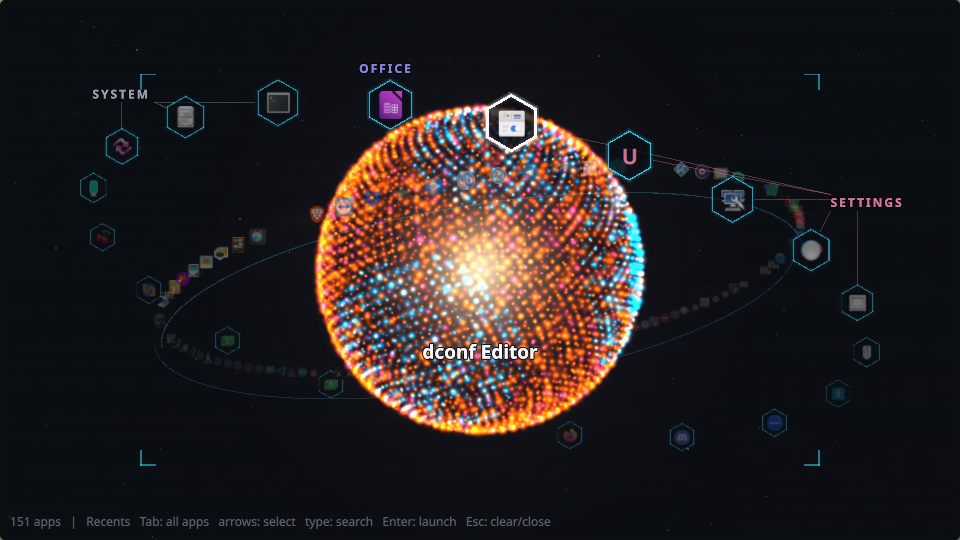
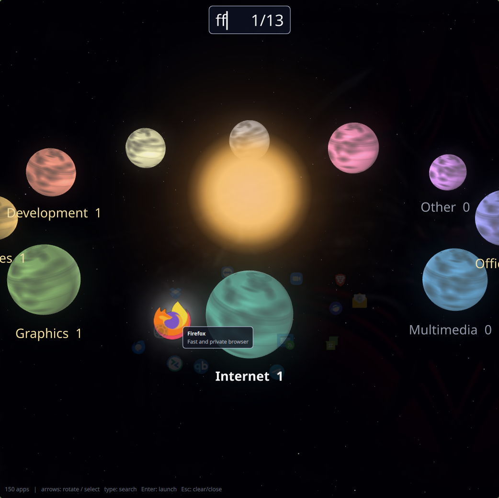
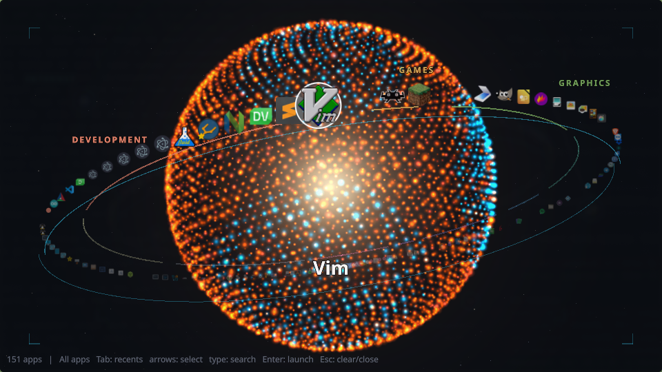
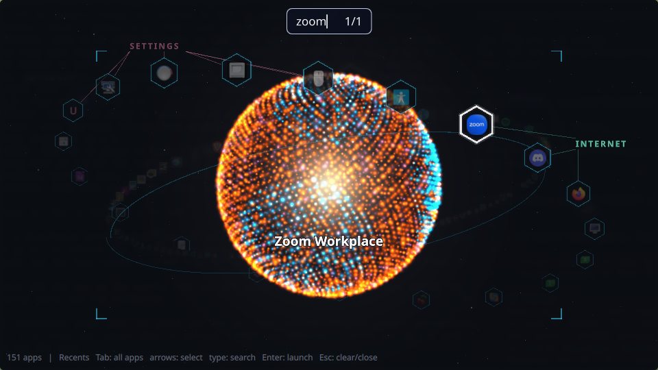
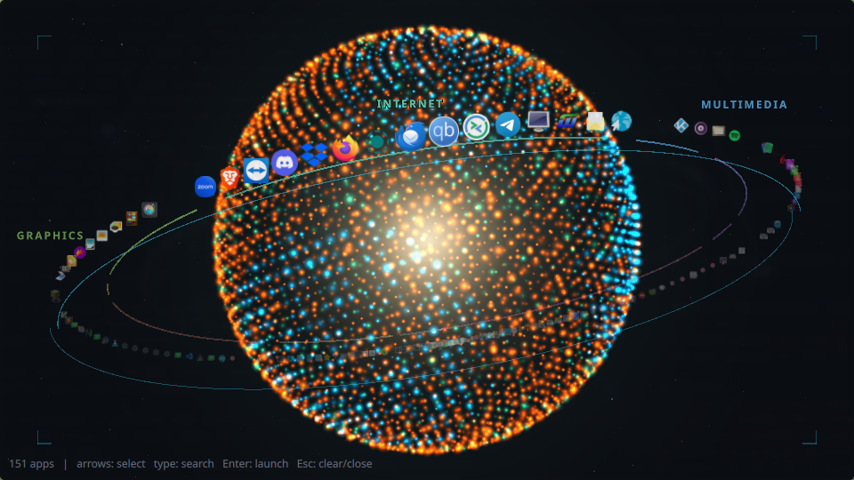

# kaos-launcher

Version 0.2.0

A 3D application launcher for Linux, built with Qt Quick 3D inside a standalone Quickshell window. Two looks, chosen by
config, a key (F2) or a command-line flag:

- **solar**: categories are planets on a ring around a glowing sun; the apps of the focused planet orbit it as moons.
- **sphere**: a glowing particle sphere with your recent apps as hexagons on an outer orbit and every other app in a ring of
  icons around it, in the style of a sci-fi HUD.

Type to search, press Enter or click to launch.

| Solar | Sphere (Recents view) |
|-------|-----------------------|
|  |  |

## Features

- Two styles (`solar`, `sphere`) sharing search, keys, state, config and launching; F2 swaps live and remembers the choice.
- Keyboard first: arrows rotate and select, Enter launches, type anywhere to search, Escape clears then closes.
- Fuzzy search on name, then keywords, then comment; the view flies to the best match, even in another category or view.
- Real app icons from the freedesktop icon theme; solar shows a hover tooltip with name and comment.
- Sphere style: your 20 most recent launches (from kaos-launcher only) as glowing hexagons grouped by category, two views
  (Recents and All apps) toggled with Tab, a launch pulse and an optional open animation, configurable colours.
- Resident background instance toggled by a command (instant open), or run-once mode.
- Reads standard `.desktop` files; handles `Terminal=true` apps and Exec field codes.
- Small TOML config file with commented defaults, created on first run.

| Solar: search | Solar: large category |
|---------------|-----------------------|
|  |  |

## Requirements

Developed and tested on Arch Linux (Quickshell 0.3.2, Qt 6.12, Hyprland 0.57, Python 3.14). The window uses the Wayland
platform plugin through Quickshell.

| Component | Needed | Arch package | Notes |
|-----------|--------|--------------|-------|
| Quickshell | required | `quickshell` (0.3.x; tested 0.3.2) | Provides `quickshell`, `Quickshell.Io`, `Quickshell.Hyprland` QML modules |
| Qt Quick 3D | required | `qt6-quick3d` | The 3D scene; pulls `qt6-shadertools`, `qt6-quicktimeline`. The sphere style's particle shaders (`dot.vert`, `dot.frag`) are compiled at run time by `qt6-shadertools`; no pre-built shader files are shipped |
| Qt 6 base, Declarative, Wayland, SVG | required | `qt6-base`, `qt6-declarative`, `qt6-wayland`, `qt6-svg` | Already dependencies of `quickshell` |
| Python 3.11+ | required | `python` | Backend, standard library only (`tomllib` needs 3.11) |
| Wayland compositor | required | any | Quickshell windows need Wayland |
| Icon theme | optional | e.g. `papirus-icon-theme` | `hicolor-icon-theme` comes with Quickshell. Without a theme most apps are plain spheres |
| Terminal emulator | optional | e.g. `kitty`, `alacritty`, `foot` | Only for apps with `Terminal=true`; must accept `-e <command>` |
| Hyprland | optional | `hyprland` | Used only to open the panel on the monitor with the focused window; elsewhere the first screen is used |
| `gsettings` | optional | `glib2` | Only to detect the icon theme when GTK 3 `settings.ini` has none; fallback is hicolor |

External commands the code runs: `python3` (backend, from QML), `quickshell` (the wrapper script), `gsettings`
(optional, icon theme detection), and the configured or detected terminal (optional). It does not call `hyprctl`
and needs no clipboard tools.

Development and tests only:

| Tool | Arch package | Use |
|------|--------------|-----|
| `ruff` | `ruff` | Python lint and format check |
| `qmllint` | `qt6-declarative` | QML lint |
| `node` | `nodejs` | Tests for `search.js` |
| `shellcheck` | `shellcheck` | Lint for the wrapper script |
| `grim` | `grim` | Optional, for screenshots |

Install on Arch:

    sudo pacman -S quickshell qt6-quick3d python

Other distributions: untested. You need Quickshell (usually built from source or a third-party package), the Qt 6
Quick 3D QML module (Debian/Ubuntu/Linux Mint: `qml6-module-qtquick3d` and related `qml6-module-*` packages),
Python 3.11 or newer, and a Wayland session. Package names there are best-effort guesses.

## Install

    git clone https://github.com/pt-kaos/kaos-launcher.git
    cd kaos-launcher

Run it in place:

    quickshell -p /path/to/kaos-launcher -n

`-n` makes a second start exit at once, giving a single instance. The `kaos-launcher` script wraps both cases: if the
instance runs it toggles show/hide, otherwise it starts one. Optionally link it onto your `PATH`:

    ln -s /path/to/kaos-launcher/kaos-launcher ~/.local/bin/kaos-launcher

The script resolves symlinks, so it finds the application directory from the link.

### Installing the command

`install.sh` installs a copy of the app and the `kaos-launcher` command, so the app no longer depends on the repository
directory. It never uses `sudo`, never installs packages (it only reports missing dependencies), never deletes recursively and
touches nothing but what it installs; add `--dry-run` to any command to see what it would do.

    ./install.sh                     # install (or upgrade): copy the runtime files and link the command to the copy
    ./install.sh status              # mode (copy or link), share directory, link target, running or not, PATH
    ./install.sh uninstall           # remove the link and the files it installed
    ./install.sh uninstall --purge   # also remove ~/.config/kaos-launcher and ~/.local/state/kaos-launcher (asks first; --yes skips it)
    ./install.sh --link              # development: no copy, the command runs the app straight from this directory

What goes where:

- The runtime files are copied to `~/.local/share/kaos-launcher` (`$XDG_DATA_HOME/kaos-launcher`; change it with `--share-dir DIR` or
  `$KAOS_SHARE_DIR`): all `*.qml`, `search.js`, `sphere.js`, `dot.vert`, `dot.frag`, `kaos_launcher.py`, the `kaos-launcher`
  wrapper (executable), `config.example.toml`, `LICENSE.md`, `README.md` and `CHANGELOG.md`. Tests, the install scripts,
  screenshots and `.git` are not copied. The file list is defined once at the top of `install.sh`, and the install fails if a
  required file is missing. A marker file `.kaos-launcher-install` (version, date, source, list of files) records what was
  installed.
- The command is the symlink `~/.local/bin/kaos-launcher` (`--bin-dir DIR` or `$KAOS_BIN_DIR`) pointing to the wrapper in the share
  directory. Make sure `~/.local/bin` is in your `PATH` (the script warns if it is not).
- Config and state stay where they always were (`~/.config/kaos-launcher`, `~/.local/state/kaos-launcher`) and are only removed
  by `uninstall --purge`.

Upgrading is re-running `./install.sh` from a newer checkout: changed files are replaced, files that an older install had and the
new version no longer has are removed (only names recorded in the marker), and it reports `Updated` or `Already up to date`.
Restart a running resident instance afterwards (`quickshell kill -p ~/.local/share/kaos-launcher`, then run `kaos-launcher`).

| Option | Meaning |
|--------|---------|
| `--share-dir DIR` | Where the copy goes (default `$KAOS_SHARE_DIR`, else `${XDG_DATA_HOME:-~/.local/share}/kaos-launcher`) |
| `--bin-dir DIR` | Where the link lives (default `$KAOS_BIN_DIR`, else `~/.local/bin`) |
| `--link` | Development mode: no copy, link straight to this directory's wrapper; `status` shows which mode is active |
| `--force` | Replace a foreign link or file in the way, or install into a non-empty share directory that has no marker; without it the script refuses with exit status 1 |
| `--purge` | `uninstall`: also remove the config and state directories after a y/N question; without a terminal it refuses unless `--yes` is given |
| `--yes` | Do not ask (purge confirmation, stopping a running instance) |
| `--dry-run` | Print what would happen, change nothing |

Details: a link that already points to this repository's wrapper (for example one made by hand) is replaced by the new link
without `--force`; a link or file that is something else is never touched without it. `uninstall` removes the link only if it points
to the installed copy or to this repository's wrapper, deletes only the files recorded in the marker (and the marker), removes
the share directory only if it is then empty, and reports any other file it finds there. If a resident instance is running from
the share directory (or from the repository directory) it offers to stop it with `quickshell kill -p <that directory>`; no other
instance is ever touched (`KAOS_INSTALL_NO_IPC=1` skips the check). The script's tests are in `install.test.sh` (temporary directories only).

## Usage

Start or toggle:

    kaos-launcher

Control a running instance directly (talks only to the instance started from that directory):

    quickshell ipc -p /path/to/kaos-launcher call launcher toggle     # or: show, hide

Choose the style for one run with `--style solar|sphere` (see Styles). A resident instance that is already running
receives the override over IPC and keeps it until it exits.

    kaos-launcher --style sphere

Start hidden (for autostart, shown at the first toggle): `KAOS_START_HIDDEN=1 quickshell -p /path/to/kaos-launcher -n`.

### Keys and mouse

| Input | Solar | Sphere |
|-------|-------|--------|
| Left / Right | Rotate the ring to the previous / next planet | Recents view: previous / next hex. All apps view: previous / next category arc |
| Up / Down | Select the previous / next moon of the focused planet (wraps) | Recents: previous / next hex. All apps: previous / next app inside the arc (wraps) |
| Tab / Shift+Tab | (ignored) | Switch between the Recents and All apps views (nothing happens without recent apps) |
| Enter | Launch the selected moon | Launch the selected hex or ring icon |
| Any text | Search (no click needed); Backspace edits | Same; the best match decides the view |
| Escape | First press clears the search, second closes; with no search text it closes directly | Same |
| Drag left/right | Rotate the ring, snapping to the nearest planet | Turn the orbit (Recents) or the ring (All apps), snapping to the nearest item |
| Click | A planet: bring it to the front. A moon: launch it | A front hex or ring icon: launch it |
| Hover | Freeze a moon and show name and comment | Highlight the item under the pointer |
| F2 | Swap between the styles; the choice is saved in `state.json` and kept across restarts | |

Launches are detached and survive closing the launcher.

### Styles

Priority for the style, highest first: (1) `--style solar|sphere` or `KAOS_STYLE` (one run, never saved); (2) the style saved in
`state.json` by F2; (3) `style` in `config.toml` (default `solar`). An invalid value at any level is ignored. Because the app
never rewrites `config.toml`, F2 stores its choice in `state.json`; once F2 has been used, editing `style` in `config.toml` has
no effect until the `style` field is removed from `state.json` (or the file is deleted). F2 while a one-run override is active
ends that override.

#### Solar

The planets-and-moons scene: categories as planets on a ring (size by app count), the apps of the focused planet as moons with
their icons, a glowing sun, a starfield, a brighter glow for the `recent_count` most recent launches.

#### Sphere

A slowly turning sphere of about 3600 soft, glowing particles (amber with cyan patches and a bright core) with two rings around
it, both seen from below like a HUD: the front arc of each ring is its upper arc, so the selected item is at the top and the
back arc runs behind the lower half of the sphere. The core shows only the selected app's name (about halfway between the centre and the border; no category name, and
the search text is in the box at the top). Some particles and a halo take the colour of the focused category. The sphere itself is not
clickable.

The panel has two views, never shown together. Tab / Shift+Tab toggle them (animated, about 0.35 s); nothing zooms by itself.
Every show starts in Recents when there are recents, else in All apps; the last view is not remembered.

| Recents view | All apps view |
|--------------|---------------|
|  |  |

- **Recents view**: your most recent launches (from kaos-launcher only, newest first, up to `hex_count`, default 20) as glowing
  hexagons on an outer orbit: a larger ellipse leaning the other way from the inner ring (+12 degrees against -9), evenly
  spaced, grouped by category with one uppercase label per group and thin connector lines from the label to its hexes. A
  hexagon's brightness shows how recent it is; the selected one is white. The orbit's front is large and clickable, its back is
  small, dim and really behind the sphere. The inner ring with all other apps is still there as a quiet band of small, dim
  icons (not clickable). The newest hex is selected on open, so Enter right after opening relaunches your latest app.
- **All apps view**: the camera moves closer (zoom 1.45), the orbit disappears and the inner ring becomes full size, with an arc
  per category (uppercase label and a thin stripe in the category colour). With no recents (first time, or `hex_count = 0`) this
  is the only view and the ring holds every app.
- **Search** works in both views and picks the view of its best match: a ring app zooms into All apps and turns the ring to it,
  a hex app goes to Recents and turns the orbit to it. Matches light up, the others dim; Up/Down cycle the matches across both
  views. The first Escape clears the search and leaves the view as it is. Tab is ignored while searching.
- **HUD**: small corner brackets frame the scene, a dim static starfield sits behind it (`starfield = false` turns it off),
  and there is no tooltip: the selected app's name is in the core (a little below its centre) and the group name on the hex or ring labels.
- **Launching** makes the sphere swell and its core flare for about 0.4 s before the panel hides (the close is delayed by that
  long; with `close_after_launch = false` the pulse plays and the panel stays).
- **Open animation** (`open_animation`, default on): on every show the particles gather into the sphere in under 0.3 s while the
  rings and hexes fade in. It does not run while the panel is hidden.
- **Colours**: `color_main`, `color_accent` and `color_base` (hex strings) restyle the sphere style; the category colours (stripes
  and group labels) stay.

Look constants that are not in the config (`showOrbitLine`, `ringRecentsAlpha`, `ringRecentsIconFrac`, particle count) are at
the top of `SphereScene.qml`. Layout rules and their tests are in `sphere.js` / `sphere.test.js`.

| Search matching a recent app | First time: no recents, All apps only |
|------------------------------|----------------------------------------|
|  |  |

Limits of the sphere style: on a square or very small panel the orbit cannot be much larger than the ring (it is scaled to fit);
more than about 8 category groups among the recents can make some group labels disappear; a freshly launched app moves from the
ring to the orbit at once (also with `close_after_launch = false`), so the ring shifts. The bottom hint line shows `Tab` only
when there are recents. Frame rate and GPU load were not measured on other hardware.

### Search

(Solar; the sphere style's search is described under Styles.) Matching moons light up and the others dim; the camera flies to the best match and selects it. The search line shows
`position/total` or `no match`; planet labels show the match count per category. While searching, Up/Down cycle
through the matches (best first, across planets); Left/Right still rotate.

Ranking, on the name first (best to worst): exact, prefix, word start ("stu" in Visual Studio Code), subsequence
anchored on the first letter ("ff" in Firefox), substring, any other subsequence. Then `Keywords=`/`GenericName=`
(word start or substring), then `Comment=` (same). Any name match outranks any keyword match, which outranks any
comment match. Case and accents are ignored. Ties: shorter name, then alphabetical.

### Grouping

Applications are read from `$XDG_DATA_HOME/applications` (default `~/.local/share`), every `$XDG_DATA_DIRS` entry and
`/usr/share`; earlier directories override later ones by file id. Skipped: `NoDisplay`, `Hidden`, non-Application types,
entries without `Name` or `Exec`. The main group is the first match in this priority order against `Categories=`:
Settings, Games, Development, Graphics, Multimedia (AudioVideo/Audio/Video), Internet (Network), Office, System,
Utility; no match goes to Other. To change it, edit `GROUPS` in `kaos_launcher.py`.

### Icons

`Icon=` is resolved per the freedesktop icon theme specification: an absolute path is used if the file exists; a name
is searched in the active theme, its `Inherits=` chain, `hicolor`, then loose files in `pixmaps/` and the icon
directories (PNG and SVG; `.xpm` is not used). The active theme is `gtk-icon-theme-name` in
`$XDG_CONFIG_HOME/gtk-3.0/settings.ini`, else `gsettings get org.gnome.desktop.interface icon-theme`, else `hicolor`;
`icon_theme` in the config overrides it.

## Configuration

File: `$XDG_CONFIG_HOME/kaos-launcher/config.toml` (default `~/.config/kaos-launcher/config.toml`). It is created with
commented defaults on first run and never overwritten afterwards; `config.example.toml` in this repository is the same
file. Invalid TOML or a bad value falls back to the default for that key; numbers are clamped to their range; unknown
keys are ignored. Changes apply at the next hide/show cycle (see Background mode). `style`, `hex_count`, `open_animation`, `name_plate` and the
`color_*` keys only affect the sphere style (`style` selects it); colours are validated (`#rgb` or `#rrggbb`, any case, stored as
`#rrggbb`) and an invalid value falls back to the default for that key.

| Key | Default | Range | Meaning |
|-----|---------|-------|---------|
| `run_in_background` | `true` | bool | Keep one resident instance; `false` exits on Escape or after a launch |
| `recent_count` | `5` | 0-20 | Recent apps with a brighter glow (0 = off) |
| `panel_size_percent` | `50` | 20-100 | Panel width and height as a percentage of the screen |
| `close_after_launch` | `true` | bool | Hide (or exit) after launching |
| `orbit_speed` | `1.0` | 0-5 | Moon orbit speed, 0 stops the orbits |
| `starfield` | `true` | bool | Faint stars in the background (both styles; static and very dim in the sphere style) |
| `icons` | `true` | bool | App icons on the moons; `false` shows plain spheres |
| `icon_theme` | `"auto"` | string | Icon theme name; `"auto"` = GTK settings, then gsettings, then hicolor |
| `terminal` | `"auto"` | string | Terminal for `Terminal=true` apps: `"auto"` (`$TERMINAL`, then kitty, alacritty, foot, wezterm, konsole, xterm) or a command accepting `-e <cmd>`; an unusable value falls back to auto with a note on stderr |
| `drag_speed` | `0.25` | 0.02-2 | Degrees of ring rotation per dragged pixel |
| `tooltip_font_size` | `11` | 6-40 | Tooltip text size in pixels |
| `hex_count` | `20` | 0-20 | Sphere style: how many recent apps are shown as hexagons instead of in the ring (0 = none) |
| `open_animation` | `true` | bool | Sphere style: assemble animation on every show (under 0.3 s); `false` shows the scene at once |
| `name_plate` | `false` | bool | Sphere style: a soft dark plate behind the app name in the core, for colour schemes where the white name is hard to read |
| `color_main` | `"#ff9a3c"` | `#rgb` / `#rrggbb` | Sphere style: particles, labels and active elements (amber) |
| `color_accent` | `"#3cd6ff"` | `#rgb` / `#rrggbb` | Sphere style: highlights, hexagon borders, brackets and connector lines (cyan) |
| `color_base` | `"#0a0d12"` | `#rgb` / `#rrggbb` | Sphere style: background and the opaque disc and plates behind the sphere |
| `style` | `"solar"` | `"solar"`, `"sphere"` | Default visual style (see Styles for precedence: F2 choice saved in `state.json` wins); invalid falls back to `"solar"` |

### State

File: `$XDG_STATE_HOME/kaos-launcher/state.json` (default `~/.local/state/kaos-launcher/state.json`):

    {"planet": "<label>", "recent": ["<desktop id>", ...], "style": "solar"|"sphere"}

`planet` is the last focused planet (solar), `recent` the last 20 launches made from kaos-launcher (newest first; the sphere style shows up
to `hex_count` of them as hexagons and solar glows the first `recent_count`), and `style` the style chosen with F2 (absent until used). Older files
with fewer entries load unchanged. Delete
it to reset. It is written atomically; a missing or corrupt file counts as empty.

## Background mode

With `run_in_background = true` (default) there is one resident process. Escape (with no search text), a launch (if
`close_after_launch`) or `toggle` hides the window; the next `toggle` shows it instantly. While hidden nothing
renders. On hide the state is saved and the generator re-runs in the background, so the next show has fresh data:
new `.desktop` apps and config edits appear after the next hide. A toggle within about 100 ms of a hide may still show
the data from before the refresh. When shown again the search is cleared, no moon is selected and the last focused
planet is in front without a fly-in (sphere style: the open animation plays instead, if enabled).

With `run_in_background = false`, Escape, a launch or `toggle`/`hide` ends the process (state saved first).

## Hyprland integration

The panel is a plain `FloatingWindow` titled `kaos-launcher`. Without rules Hyprland tiles it, so `panel_size_percent`
is only a size hint. A window rule is needed to float, centre and size it. Other compositors need equivalent rules, or
you can replace only `shell.qml` with a layer-shell variant; the controller (`Launcher.qml`) and scenes do not depend on the
window type.

Rule semantics for a window with title `kaos-launcher`: float, centre, size to the same percentage as
`panel_size_percent`, optionally no border and no animation. Bind a key to the `kaos-launcher` command, and
optionally start the resident instance hidden at login.

Example `hyprland.conf` (classic syntax; adapt it, the rule syntax differs between Hyprland versions and Lua
configurations express the same rules with their own API, so check the documentation for your version):

    # hotkey: toggle (or start) the launcher
    bind = SUPER, SPACE, exec, /path/to/kaos-launcher/kaos-launcher

    # autostart, resident and hidden until the first toggle
    exec-once = env KAOS_START_HIDDEN=1 quickshell -p /path/to/kaos-launcher -n

    # window rules (Hyprland 0.53+ syntax)
    windowrule = float on, match:title ^(kaos-launcher)$
    windowrule = center on, match:title ^(kaos-launcher)$
    windowrule = size monitor_w*0.5 monitor_h*0.5, match:title ^(kaos-launcher)$

    # older versions used:
    # windowrulev2 = float, title:^(kaos-launcher)$
    # windowrulev2 = center, title:^(kaos-launcher)$
    # windowrulev2 = size 50% 50%, title:^(kaos-launcher)$

Closing the panel when it loses focus is not implemented: clicking outside does nothing.

## Development and testing

Run in this directory:

    PYTHONDONTWRITEBYTECODE=1 python3 -m unittest -q
    node --test search.test.js sphere.test.js
    ruff check . && ruff format --check .
    qmllint -I /usr/lib/qt6/qml Launcher.qml SolarScene.qml SphereScene.qml Glow.qml DotMaterial.qml   # one file per call; shell.qml makes qmllint exit silently
    shellcheck kaos-launcher install.sh install.test.sh
    ./install.test.sh

To try it without touching your own configuration, point the XDG directories at a scratch location:

    env XDG_CONFIG_HOME=/tmp/kl/cfg XDG_STATE_HOME=/tmp/kl/state quickshell -p /path/to/kaos-launcher -n

`KAOS_DEBUG=1` (the variable goes before the command) logs hover, press/release, pick results, launches, focus and key
events, and runs a scripted pick test and keyboard/search self-test a few seconds after start (query from
`KAOS_DEBUG_QUERY`, default `ff`). In the debug mode it also logs a frame-rate estimate every 2 s (`fps ...`, with style and view)
and the time of the first frame after the first load.

Files:

| File | Purpose |
|------|---------|
| `kaos_launcher.py` | Backend. `init [--save-planet X]` prints `{config, state, graph}` JSON and creates the default config; `graph` prints the graph; `launch <desktop file> [--id ID] [--planet X]` strips Exec field codes, wraps `Terminal=true` entries in a terminal, starts the process in a new session and records the id; `save [--planet X] [--style S]` stores the focused planet and/or the chosen style |
| `shell.qml` | Host: `FloatingWindow`, monitor choice, show/hide logic, IPC handler (`launcher` target) |
| `Launcher.qml` | Controller, independent of the style: data load, search, launching, keys (Shortcuts), search line, status; loads the scene by `style`. The scene interface is documented at its top |
| `SolarScene.qml` | Solar style: 3D ring carousel, moon orbits, picking, tooltip. Fixed look constants at the top |
| `SphereScene.qml` | Sphere style: instanced particle sphere (Qt Quick 3D), ring of icons as a 2D overlay, core text, mouse |
| `sphere.js`, `sphere.test.js` | Pure sphere-style logic with tests: ring layout, orbit geometry, label and connector placement, views and fades, brackets, starfield, particle generation, layer order |
| `DotMaterial.qml`, `dot.vert`, `dot.frag` | The soft round particle: an unlit additive custom material with a camera-facing quad per instance and the open animation |
| `Glow.qml` | Camera-facing soft glow sprite |
| `search.js`, `search.test.js` | Pure fuzzy-match and ranking functions and their tests |
| `test_kaos_launcher.py` | Backend tests |
| `kaos-launcher` | Toggle-or-start wrapper script |
| `install.sh`, `install.test.sh` | Installer for the `kaos-launcher` command (symlink) and its uninstall, with tests |
| `config.example.toml` | Default config |

## Known limits

- A `FloatingWindow` is tiled by Hyprland unless a window rule exists (see above).
- Single instance needs `-n` (or the `kaos-launcher` script); a bare `quickshell -p <dir>` run twice starts two.
- New apps and config edits apply at the next hide (rescan on hide); with `run_in_background = false` at each start.
- SVG icons are rasterised at their intrinsic size, so some look soft when enlarged; a corrupt icon draws as an empty
  billboard. `.xpm` icons are unsupported. Flatpak and AppImage directories are not scanned unless their `.desktop`
  files are in an `applications` directory of `XDG_DATA_DIRS`.
- Dimmed (non-matching) moons are small and faint on purpose. Icons overlap on categories with many apps, and moons
  behind the front planet are hidden until they orbit round.
- Moon names show only in the tooltip.
- Non-ASCII search input depends on the compositor delivering key text; there is no IME or compose support.
- Keywords come from the non-localised `Keywords=` only.
- Only tested on Arch Linux with Hyprland. Other distributions and compositors are untested.

## License

MIT, see [LICENSE.md](LICENSE.md).
